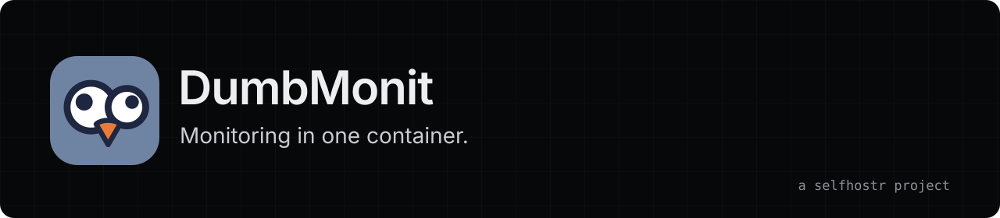
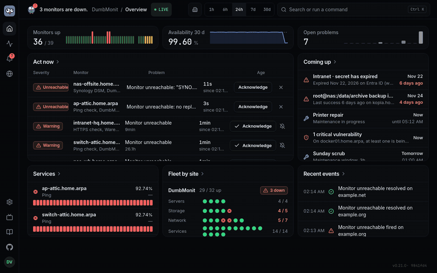
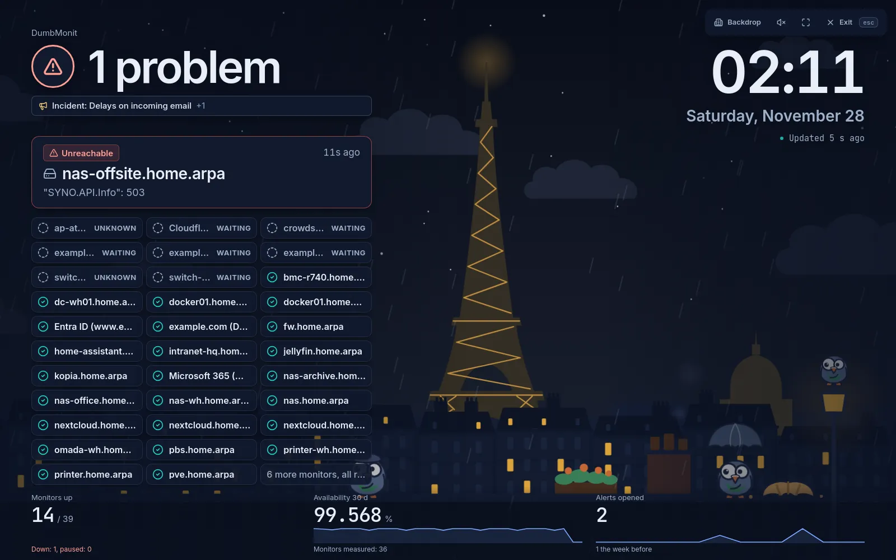
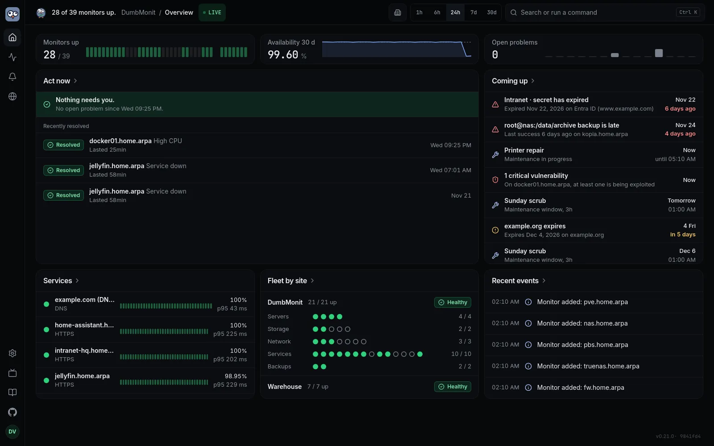
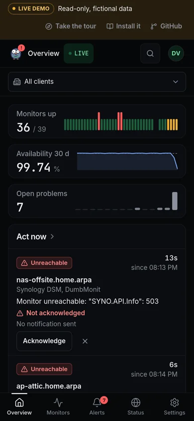

<div align="center">
<a href="https://dumbmonit.selfhostr.io"></a>

**Self-hosted monitoring for your homelab or small team. One container, no assembly.**

[Site](https://dumbmonit.selfhostr.io) · [Docs](https://dumbmonit.selfhostr.io/docs/) · [Live demo](https://dumbmonit.selfhostr.io/demo/) · [Changelog](CHANGELOG.md)

[](https://github.com/selfhostr/dumbmonit/actions/workflows/ci.yml) [](LICENSE)


</div>

dumbmonit watches servers, network gear, hypervisors, storage, applications and websites from a single console. No Prometheus, Grafana and Alertmanager to assemble, no database to administer. MIT licence, no paid edition.

## What you get

- **A first graph in minutes.** Pick a device type, fill a few fields. Over 100 integrations, each [documented](https://dumbmonit.selfhostr.io/docs/devices/).
- **One notification instead of thirty.** When a switch dies, everything behind it is held back. Maintenance windows and silences included, 38 notification channels.
- **Something to put on the wall.** A full-screen room monitor, plus public status pages for your users or family.
- **Agents for Linux, Windows, macOS and FreeBSD,** deployable to a whole Windows domain with one group policy. Encrypted channel.
- **Yours.** Data stays in your volume. Sign in with TOTP, passkeys, OIDC, SAML or LDAP. API and MCP server included. Native mobile apps are coming soon; the console is an installable PWA today.

<p align="center">


<br>

</p>

## Quick start


```bash
mkdir dumbmonit && cd dumbmonit
curl -fsSLO https://raw.githubusercontent.com/selfhostr/dumbmonit/main/docker-compose.yml
docker compose up -d
docker compose logs dumbmonit   # one-time code for the first admin account
```

Open https://localhost:8080 (self-signed certificate, accept the browser warning once). The setup wizard starts with your first monitor, where alerts go and a test alert: [first alert in five minutes](https://dumbmonit.selfhostr.io/docs/install/quickstart/). Back up *Settings → Backup* **and** `/data/secret.key`. Updating, ports and lost password: see the [installation guide](https://dumbmonit.selfhostr.io/docs/install/docker/).

On Kubernetes: a Helm chart (`oci://ghcr.io/selfhostr/charts/dumbmonit`) and plain manifests live in [`deploy/`](deploy/); see the [Kubernetes guide](https://dumbmonit.selfhostr.io/docs/install/kubernetes/).

## How it compares

Each of these is a good tool; the choice depends on what you watch.

| | dumbmonit | Uptime Kuma | Beszel | Zabbix |
|---|---|---|---|---|
| Setup | One container | One container | Hub + agents | Server, database, frontend |
| Website checks | Yes | Best in class | No | Yes |
| Server metrics | Agent | No | Light and simple | Yes |
| SNMP, NAS, hypervisors | Built-in profiles | Basic | No | Templates galore |
| Alert grouping by topology | Yes | No | No | Yes (dependencies) |
| Status pages | Yes | Yes | No | No |
| Maturity | Young (0.x) | Large community | Young | Decades |

Pick Uptime Kuma if you only need "is my site up", Beszel for lightweight host stats, Zabbix for proven scale and high availability. Pick dumbmonit for hosts, network gear, storage and sites in one small console.

## Architecture

One Rust binary with the UI embedded, VictoriaMetrics started by it, SQLite for configuration. Agents talk to the server over an encrypted channel (TLS 1.3, client certificates). See the [documentation](https://dumbmonit.selfhostr.io/docs/) for details.

## Limits

- Some integrations have only met test instances, not years-old production hardware. Validate dumbmonit in your own environment before you rely on it.
- Before 1.0, the HTTP API and the database schema can still change between minor versions (see the changelog).

## Contributing

Issues and pull requests are welcome: [CONTRIBUTING.md](CONTRIBUTING.md). Security issues: [SECURITY.md](SECURITY.md).

## License

MIT, see [LICENSE](LICENSE). Provided "as is", without warranty of any kind.

## Support

dumbmonit is free and has no company behind it. If it saves you time: [sponsor us on GitHub Sponsors](https://github.com/sponsors/selfhostr).
