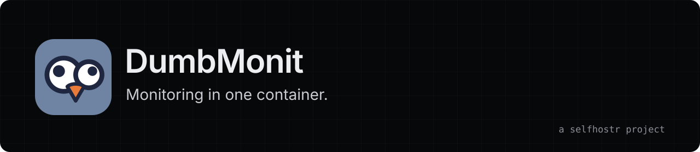

<div align="center">
<a href="https://dumbmonit.selfhostr.io"></a>

**Self-hosted monitoring for homelabs, small teams and mid-sized companies.**

[Site](https://dumbmonit.selfhostr.io) · [Docs](https://dumbmonit.selfhostr.io/docs/) · [Demo](https://dumbmonit.selfhostr.io/demo/) · [Changelog](CHANGELOG.md)

[](https://github.com/selfhostr/dumbmonit/actions/workflows/ci.yml) [](LICENSE)
</div>

## Overview

dumbmonit watches servers, network gear, hypervisors, storage, applications and websites from a single console. No Zabbix to operate, no Prometheus, Grafana and Alertmanager to assemble. Free, for good: MIT licence, no paid edition.

## Quick start

```bash
mkdir dumbmonit && cd dumbmonit
curl -fsSLO https://raw.githubusercontent.com/selfhostr/dumbmonit/main/docker-compose.yml
docker compose up -d
docker compose logs dumbmonit   # one-time code for the first admin account
```

Open https://localhost:8080 (self-signed certificate, accept the browser warning once). Back up *Settings → Backup* **and** `/data/secret.key`. Updating, ports and lost password: see the [installation guide](https://dumbmonit.selfhostr.io/docs/install/docker/).

## Features

- **Over 100 integrations.** SNMP, firewalls, Proxmox, vSphere, Synology, TrueNAS, Kubernetes, databases, HTTP/TCP/DNS/TLS checks and more, each [documented](https://dumbmonit.selfhostr.io/docs/devices/).
- **Agent.** Linux, Windows, macOS and FreeBSD, deployable to a whole Windows domain with one group policy.
- **Quiet alerting.** A parent that is down hides its children, maintenance windows, silences, forecasts.
- **38 notification channels.** Discord, Slack, Telegram, Matrix, ntfy, email, PagerDuty, webhook and more.
- **Public status pages.** History, incidents, email subscribers and badges.
- **API and MCP server.** 28 tools, plus Prometheus and Grafana access.
- **Access control.** TOTP, passkeys, OIDC, SAML and LDAP / Active Directory sign-in.
- **Encrypted backup,** HTTPS only, installable phone app (PWA).

## Architecture

One Rust binary with the UI embedded, VictoriaMetrics started by it, SQLite for configuration. Agents talk to the server over an encrypted channel (TLS 1.3, client certificates). See the [documentation](https://dumbmonit.selfhostr.io/docs/) for details.

## Limits

- Some integrations have only met test instances, not years-old production hardware. Validate dumbmonit in your own environment before you rely on it.
- Before 1.0, the HTTP API and the database schema can still change between minor versions (see the changelog).
- Formerly called ezymonit; the old `EZYMONIT_*` variables are still accepted.

## Contributing

Issues and pull requests are welcome: [CONTRIBUTING.md](CONTRIBUTING.md). Security issues: [SECURITY.md](SECURITY.md).

## License

MIT, see [LICENSE](LICENSE). Provided "as is", without warranty of any kind.

## Support

dumbmonit is free and has no company behind it. If it saves you time: [sponsor us on GitHub](https://github.com/sponsors/selfhostr).
